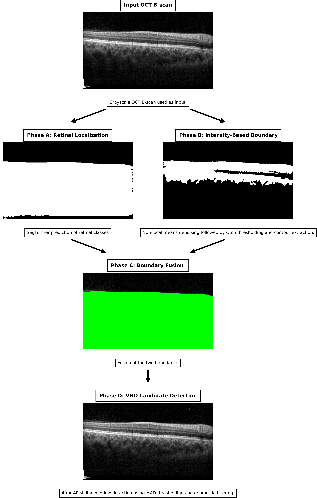

# Automated Hybrid Pipeline for Vitreous Hyperreflective Dot Detection in OCT B-Scans

A documentation-first overview of a hybrid computer-vision pipeline for **candidate vitreous hyperreflective dot (VHD) localization** in optical coherence tomography (OCT) B-scans. The pipeline combines a SegFormer-based retinal segmentation with an intensity-derived boundary estimate, fuses the two estimates to define a vitreous region of interest (ROI), and applies local contrast and robust-statistics-based candidate detection.

> **Research status:** This repository documents the pipeline and illustrative outputs. The manuscript is prepared and is under internal review; publication details will be added when soon.


## Pipeline overview



The two boundary-estimation branches operate on the same grayscale B-scan. Their outputs are fused and regularized before the detector searches only within the resulting vitreous ROI.

## Representative output



*Illustrative output from the current pipeline. Markers represent algorithm-generated candidates, not independently confirmed VHDs. This image must not be publicly distributed without the required data-release approval.*

## Results
The proposed pipeline was evaluated against clinician-marked reference dots on a manually reviewed OCT validation set.

| Evaluation Metric                                   | Result |
| --------------------------------------------------- | ------ |
| Dot-level Recall (Sensitivity)                      | 85.7%  |
| Dot-level Precision (at 3-pixel matching tolerance) | 92%    |

**Evaluation Protocol:** A predicted dot was considered a true positive if its centre was within a 3-pixel Euclidean distance of a unique clinician-marked reference dot. Each prediction and reference annotation was matched at most once. Unmatched predictions were counted as false positives, while unmatched reference dots were counted as false negatives.

The results indicate that the pipeline identifies a substantial proportion of clinician-marked dots while maintaining a relatively high proportion of spatially matched predictions.

**Note:** These results are conducted only on a part of the dataset and evaluation on additional OCT scans and further assessment of detection consistency are ongoing.

## Method

The pipeline has three stages. It is designed so that detection is performed only within an anatomically defined vitreous region, which reduces false candidates from retinal tissue and noise.

### 1. Vitreous region-of-interest estimation

Two complementary boundary estimates are computed from the same B-scan:

- **Learning-based:** a pretrained SegFormer model segments retinal structures, and the segmentation is converted into an upper retinal boundary profile.
- **Intensity-based:** classical image processing (denoising, thresholding and contour extraction) provides an independent boundary estimate directly from pixel intensities.

The two estimates are combined through a boundary-fusion step and regularized into a smooth envelope. The region above this envelope, with a safety margin, defines the vitreous ROI. Using both estimates keeps the boundary usable when either one is locally unreliable.

### 2. Local contrast-based candidate detection

Within the ROI, the scan is analysed with overlapping sliding windows. In each window, a high-pass residual is computed to suppress slowly varying background, and a robust threshold based on the median absolute deviation (MAD) is applied so that the threshold adapts to local noise:

```math
T = \mathrm{median}(H) + k \cdot 1.4826 \cdot \mathrm{MAD}(H)
```

Here $H$ is the local residual and $k$ is a tunable multiplier. Windows that look noise-dominated are rejected, and candidate maps from overlapping windows are merged.

### 3. Candidate refinement and logging

Candidate regions are cleaned with morphological operations and filtered by geometric properties (size, circularity and aspect ratio) to suppress noise. Each candidate is logged with its position, shape measurements, intensity and an accept/reject decision with a reason, so every result can be audited.

## Outputs

- A visual overlay of the original OCT B-scan and candidate locations.
- A per-scan count of retained candidates.
- A CSV log of candidate positions, geometry, intensity, verdict and rejection reason.

## Scope and limitations

- 
- Visual examples alone do not establish detection accuracy or clinical utility.

## Repository structure

```text
automated-hybrid-vhd-detection/
├── README.md
└── assets/
    ├── pipeline_overview.svg
    └── example_output.png
```

## Citation

Manuscript: *Automated Hybrid Pipeline for Vitreous Hyperreflective Dot Detection in OCT B-Scans* (under internal review). A formal citation and DOI will be added once the work is publicly available.